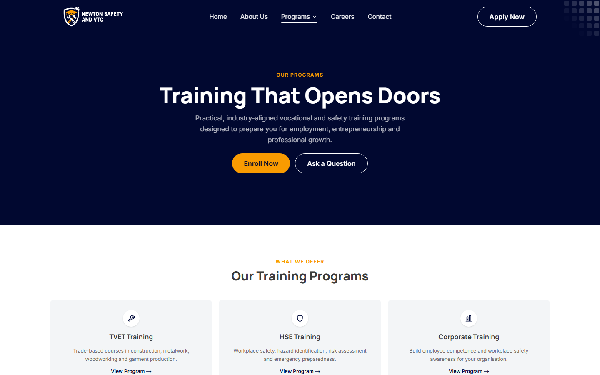
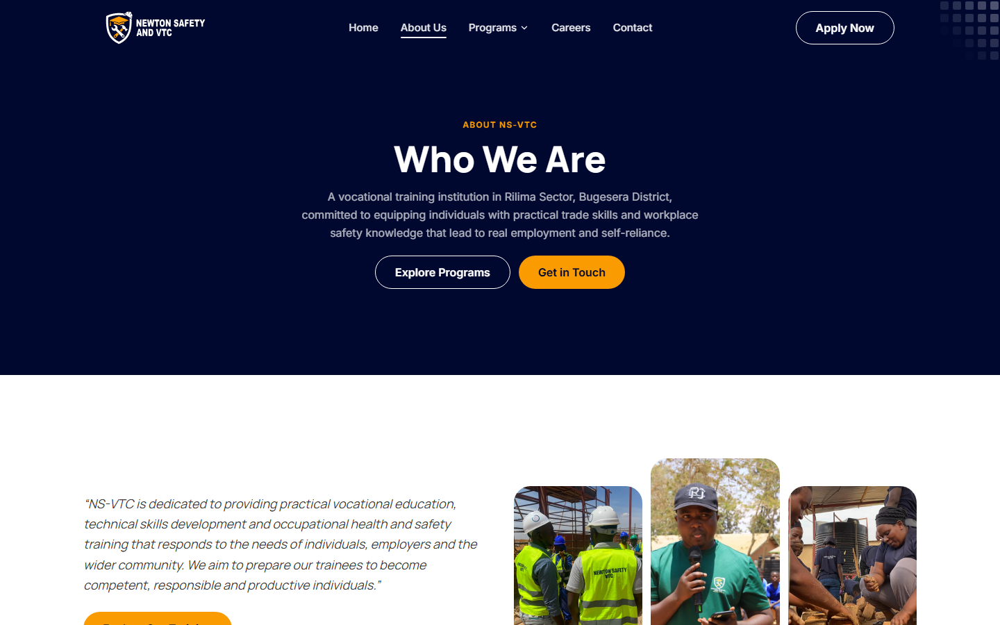
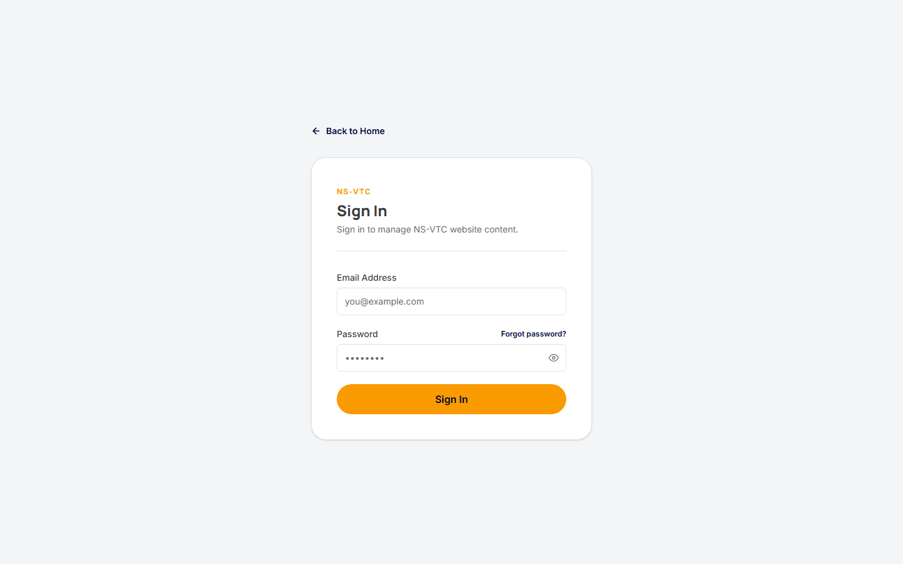

# NS-VTC Website

The public website and admin panel for **Newton Safety and Vocational Training Center (NS-VTC)**, a TVET, HSE and corporate training institution in Rilima Sector, Bugesera District, Rwanda.

Built with Next.js (App Router, static export), Tailwind CSS, and Firebase (Auth + Firestore) for the admin backend.

## Screenshots

| Home | Programs |
|---|---|
|  |  |

| About | Admissions |
|---|---|
|  |  |

| Admin Sign In |
|---|
|  |

## Features

- **Public site** — Home, About, Programs (TVET, HSE, Corporate Training), Admissions, Careers, blog posts, and a contact/admissions intake form.
- **Admin panel** (`/admin`) — Firebase Auth–gated dashboard for managing:
  - Contact form submissions
  - Course applications (with CSV export)
  - Job postings (create, edit, archive, CSV export)
- SEO: per-page metadata, canonical URLs, JSON-LD structured data, generated `sitemap.xml` and `robots.txt`.

## Tech Stack

- [Next.js 16](https://nextjs.org) (App Router, static export via `output: "export"`)
- React 19, Tailwind CSS 4
- Firebase Auth + Firestore (admin data and authentication)
- GSAP / Motion for animations

## Getting Started

1. Install dependencies:

   ```bash
   npm install
   ```

2. Copy `.env.example` to `.env.local` and fill in your Firebase project's config:

   ```bash
   cp .env.example .env.local
   ```

   `NEXT_PUBLIC_FIREBASE_*` values come from your Firebase project settings. `ADMIN_EMAIL` / `ADMIN_PASSWORD` are only needed to run the seed script and must match an existing user in Firebase Console → Authentication → Users.

3. Run the development server:

   ```bash
   npm run dev
   ```

   Open [http://localhost:3000](http://localhost:3000).

## Scripts

| Command | Description |
|---|---|
| `npm run dev` | Start the local dev server |
| `npm run build` | Production build (static export to `out/`) |
| `npm run start` | Serve the production build locally |
| `npm run lint` | Run ESLint |
| `npm run seed` | Seed Firestore with sample jobs/applications for local dev (requires `ADMIN_EMAIL`/`ADMIN_PASSWORD`) |

## Deployment

This is a static export (`output: "export"` in `next.config.ts`), so it can be hosted on any static host. The repo includes config for:

- **Vercel** — connect the repo and set the `NEXT_PUBLIC_FIREBASE_*` variables as project environment variables (Settings → Environment Variables), then redeploy.
- **Firebase Hosting** — via `firebase.json` / `.firebaserc` (`firebase deploy`).
- **GitHub Pages** — via `.github/workflows/deploy.yml`, which builds with repo secrets and pushes `out/` to the `deploy` branch.

Whichever target is live, the `NEXT_PUBLIC_FIREBASE_*` values are baked into the JS bundle at build time, not read at runtime — update them wherever the build actually runs, then trigger a new build.
